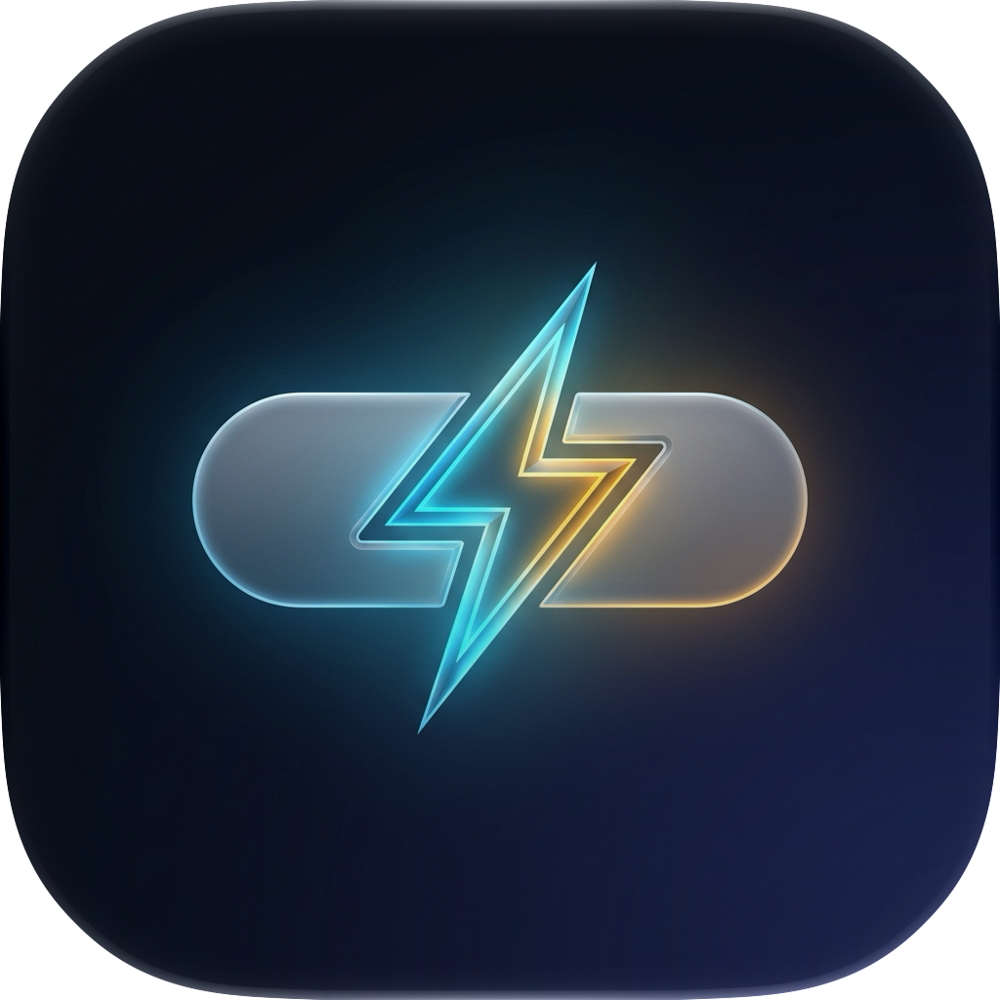

<p align="center">
  
</p>

<h1 align="center">SparkBar</h1>

<p align="center">
  <strong>Ultra-lightweight, 100% native macOS AI Spotlight Launcher (<code>⌥ + Space</code>) & Autonomous Tool Agent</strong><br/>
  Built with pure Swift, SwiftUI, and AppKit (<code>NSPanel</code>) — zero Electron bloat.
</p>

<p align="center">
  <a href="https://github.com/r0bledas/SparkBar/releases/latest">
    
  </a>
  
  
  <a href="LICENSE">
    
  </a>
</p>

---

**SparkBar** is an ultra-lightweight, 100% native macOS AI launcher and autonomous tool agent built with **Swift, SwiftUI, and AppKit** (`NSPanel`).

Press **`⌥ + Space`** (`Option + Space`) from anywhere on your Mac to summon a sleek, translucent Spotlight-style floating prompt bar. Unlike Electron-wrapped desktop AI apps that consume **800 MB – 1.5 GB of RAM**, SparkBar idles at **~25–35 MB of RAM** and opens in under **20ms**.

---

## 💬 Why This Exists (A Small Rant)

OpenAI had a good thing going with the original native macOS ChatGPT app and its instant `Option + Space` companion bar—and then they decided to migrate everything into the unified **Codex** app (`com.openai.codex`), relegating the old app to *"ChatGPT Classic"* and replacing a lightweight launcher with a full-blown **Electron super-app** that bundles Chat, Work, and an entire IDE workspace into a 1 GB+ RAM hog.

And the **Gemini** macOS app isn't the answer either. Sure, it exists as an alternative, but it hits you with a splash icon and a splash window when all you wanted was a prompt box.

When I press `⌥ + Space`, **I need it to be immediate.**
- I don't need splash icons or splash windows.
- I don't need an Electron wrapper burning a whole gigabyte of RAM in the background just to render a text box.
- I just want to press `⌥ + Space`, ask a question, search the live web, or have an autonomous agent run a local task—**instantly**—and get out of my way.

So I built **SparkBar**: pure native Swift, SwiftUI, and AppKit `NSPanel`. Zero splash screens, zero Electron, zero bloat.

---

## ✨ Features

* **Featherweight Native Architecture:** Pure Swift & AppKit `NSPanel` with `.nonactivatingPanel`, `NSVisualEffectView` HUD blur, and magnetic axis snapping with trackpad haptic alignment—zero Chromium/Electron bloat.
* **Instant Global Hotkey (`⌥ + Space`):** Registered via native macOS Carbon Event Manager (`RegisterEventHotKey`). Press `Option + Space` to summon or dismiss from any space or full-screen app.
* **Zero-Discovery Host Environment Manifest:** Automatically captures your login shell `PATH` (`/bin/zsh -lc`, Homebrew, Node, Rust/Cargo, Python) once at startup and injects a pre-probed environment manifest into the system prompt so the agent never wastes turns guessing installed tools.
* **Hermes Agent & OpenCode-Inspired Autonomous Tool Engine:**
  * `run_command` — Stateful login-shell execution (`cd` persists across turns) with a 30s synchronous window and automatic promotion to tracked background jobs.
  * `job_status` / `job_cancel` — Monitor live stdout/stderr, PID, and exit codes of background builds or long-running scripts.
  * `render_pdf` & `pdf_info` — Native 1-call HTML/Markdown to PDF generation (`WKWebView.createPDF`) and reliable page count/metadata verification via macOS `PDFKit`.
  * `web_search` & `fetch_url` — Live web search via native offscreen WebKit rendering and clean readable text extraction.
  * `read_file` / `write_file` / `list_directory` — Fast local filesystem inspection and editing.
  * `clipboard` — Read from or write directly to the macOS system pasteboard (`NSPasteboard`).
* **Persistent Conversation History & Markdown Logs (`⌘ + Y`):**
  * Every conversation, reasoning chain, and tool execution is automatically persisted in `~/Library/Application Support/SparkBar/conversations/` and exported as clean human-readable `.md` logs in `~/Library/Application Support/SparkBar/logs/`.
  * Browse, search, and resume any past conversation directly inside SparkBar via `⌘ + Y` or the History button.
* **Dynamic API Model Discovery (`GET /v1/models`):**
  * Automatically fetches live models and supported Thinking Effort levels (`None`, `Default`, `Low`, `High`, `Max`) from **DeepSeek**, **OpenAI**, **OpenRouter**, **Anthropic Claude**, **Groq**, **Google Gemini**, and **Local Ollama / LM Studio**.
* **Rich Markdown, Tables & Native LaTeX Rendering:**
  * Supports GitHub-flavored Markdown tables, ASCII box-drawing tables, syntax-styled code blocks, and native KaTeX math blocks (`$$...$$` and `$...$`).

---

## 🚀 Quick Start

### 1. Download Prebuilt macOS `.dmg`
Grab the latest `SparkBar.dmg` from [**GitHub Releases**](https://github.com/r0bledas/SparkBar/releases/latest) and drag `SparkBar.app` into `/Applications`.

### 2. Build & Run from Source (Swift Package Manager)

```bash
git clone https://github.com/r0bledas/SparkBar.git
cd SparkBar
./Scripts/package_app.sh
cp -R dist/SparkBar.app /Applications/
open /Applications/SparkBar.app
```

---

## ⌨️ Keyboard Shortcuts

| Shortcut | Action |
| :--- | :--- |
| **`⌥ + Space`** (`Option + Space`) | Summon or hide SparkBar from any app or full-screen space |
| **`Return`** | Send prompt |
| **`Esc` / `⌘ + W`** | Dismiss floating panel (or close History view) |
| **`⌘ + N` / `⌘ + K`** | Save current thread to log & start a New Chat |
| **`⌘ + Y`** | Toggle Conversation History & Logs browser |
| **`⌘ + ,`** | Open Settings & API Keys |
| **`⌘ + Q`** | Quit SparkBar |

---

## 🔑 Configuring API Keys

You can configure your API keys in two ways:
1. **In-App Settings (`⌘ + ,`):** Select your provider (DeepSeek, OpenAI, OpenRouter, Anthropic, Groq, Gemini, or Ollama) and paste your key. Keys are stored securely in the macOS Keychain.
2. **Environment Variables:** SparkBar automatically detects `DEEPSEEK_API_KEY`, `OPENAI_API_KEY`, `OPENROUTER_API_KEY`, `ANTHROPIC_API_KEY`, `GROQ_API_KEY`, and `GEMINI_API_KEY`.

---

## 📄 License

Released under the [MIT License](LICENSE).
